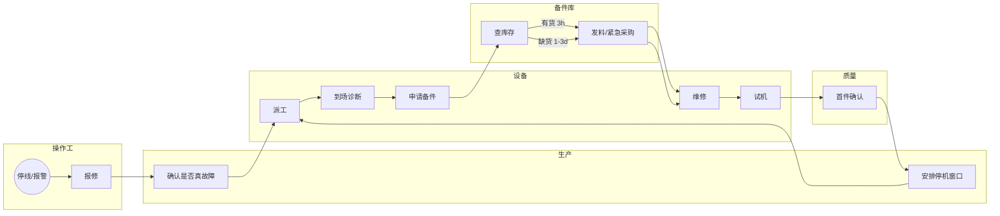

# 02 现状图（IS：设备故障到复机）

> 本文件回答：一次故障从报警到复机，实际经过哪些人、卡在哪。

- 触发点：操作工发现异常并停线（或设备报警）
- 终点：设备复机、首件确认合格、恢复生产
- 现状：14 个步骤、4 次跨部门交接、平均 6.2 h（其中干活 1.8 h，等待 4.4 h）

## 耗时与等待

| 段 | 干活 | 等待 | 说明 |
|---|---|---|---|
| 发现 → 报修 | 5 min | 25 min | 微信群，常被刷屏漏看 |
| 报修 → 派工 | 10 min | 40 min | 设备主管不在时无人派 |
| 派工 → 到场 | 20 min | 60 min | 维修工在另一条线 |
| 诊断 → 备件 | 30 min | 2–48 h | 缺货走紧急采购 |
| 维修 → 试机 → 首件 | 60 min | 45 min | 质量排程插不进 |
| 首件 → 恢复 | 5 min | 20 min | 等生产确认 |

**结论**：等待 4.4 h 占 71%，其中"等备件"和"等派工"合计占一半以上。
