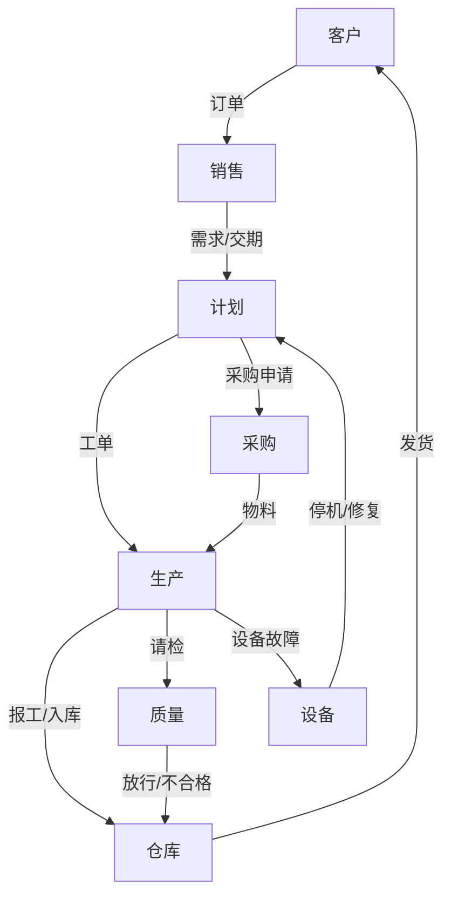
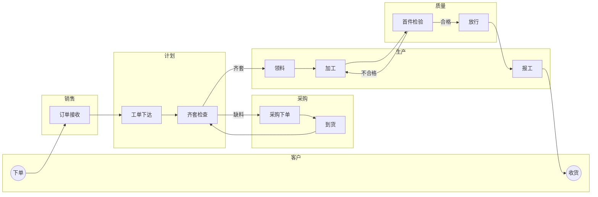

# 画图：关系图 + 跨职能泳道图

## 一、关系图（谁欠谁什么）— 5 步

1. 列出全部相关职能（含外部：客户、供应商），每个画一个方框。
2. 每个方框写出它对外的**产出**（给谁什么，含信息/单据）。
3. 用箭头连出**客户—供应商**关系（谁接收谁的产出）。
4. 每条箭头标：产出物 + 关键要求（时间/精度/格式）。
5. 找断点：缺的箭头、多余的箭头、指向错的箭头、要求不清的箭头。

**合格标准**：只看这张图，能说出"哪个部门卡着谁"。

> 箭头旁边没写"给什么"，就等于没画。

## 二、跨职能泳道图（活怎么走）— 6 步

1. **顶行写客户**，**底行写供应商**，中间按职能排泳道。
2. 定**触发点**（客户下单 / 设备报警 / 需求提出）和**终点**（客户签收 / 收款 / 设备复机）。
3. 从触发点走到终点，每一步落进对应泳道。
4. 步骤写成"**名词 + 过去式**"：订单接收、工单下达、物料齐套检查、首件检验。
5. 标：关键接口（跨泳道箭头）、每段耗时、判断分支（yes/no）、返工回路。
6. **第一遍不标断点**，先把事实画准；第二遍再贴断点编号。

**耗时怎么标**：在箭头上写 `3d`、`4h`；在节点后加 `(等 2d)` 表示等待。**等待时间往往占 70%，这才是客户抱怨的来源。**

## 三、常见画错（逐条对照）

| 错误 | 后果 | 修法 |
|---|---|---|
| 只画"应该怎样"，不画"实际怎样" | 得到一张理想图，诊断无效 | 先画 IS，现场问"上次这单实际怎么走的" |
| 用部门名当步骤（"生产部"） | 看不出动作 | 改成"名词+过去式"的步骤 |
| 没有触发点和终点 | 边界模糊，越画越大 | 先写死起止，超出的另开一张 |
| 不标耗时 | 找不到"等"在哪 | 每段标干活时间与等待时间 |
| 一边画一边改流程 | 事实与主张混在一起 | 第一遍只记录，第二遍才标断点 |
| 只画主干，不画返工 | 掩盖了最大的浪费 | 返工回路必须画出来并标比例 |

## 四、访谈时怎么画（30 分钟版）

1. 白纸横放，先画三条横线分成四道泳道（客户/计划/生产/支持）。
2. 问："这单最开始是谁、因为什么动作起来的？"→ 画触发点。
3. 问："然后交给谁？给他什么？"→ 一箭头一步，边问边画。
4. 问："这一步要等多久？实际干多久？"→ 标时间。
5. 问："有没有退回重来的情况？"→ 画返工回路。
6. 最后问："哪一步最让你想骂人？"→ 打星号，作为断点候选。

## 五、导出

- Mermaid 直接进 Markdown 汇报；
- 要精美版：`office-pptx` 生成 16:9 单页，泳道用矩形分组，断点用红色标签。
